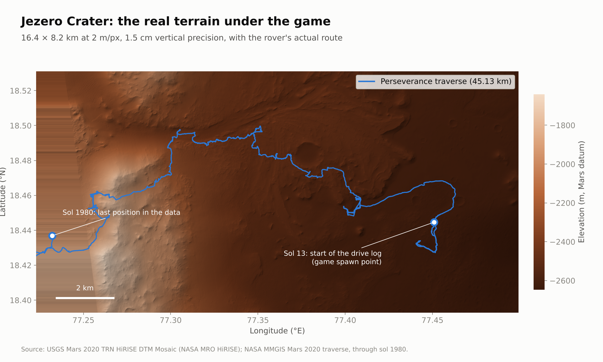
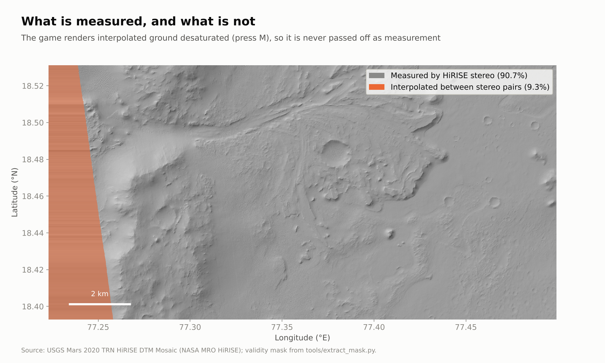
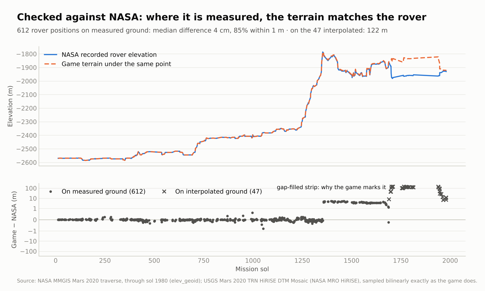
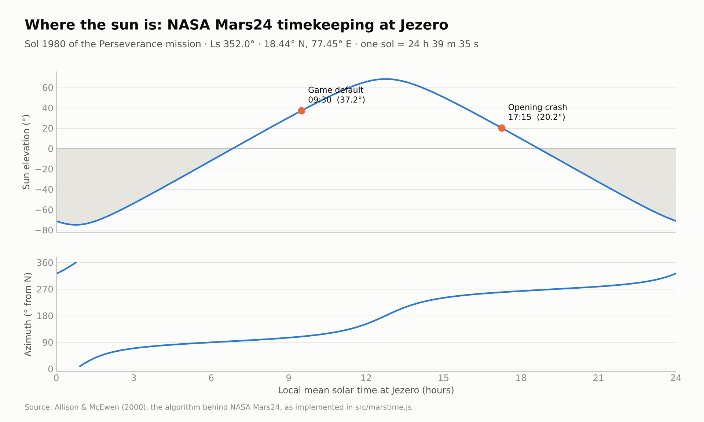
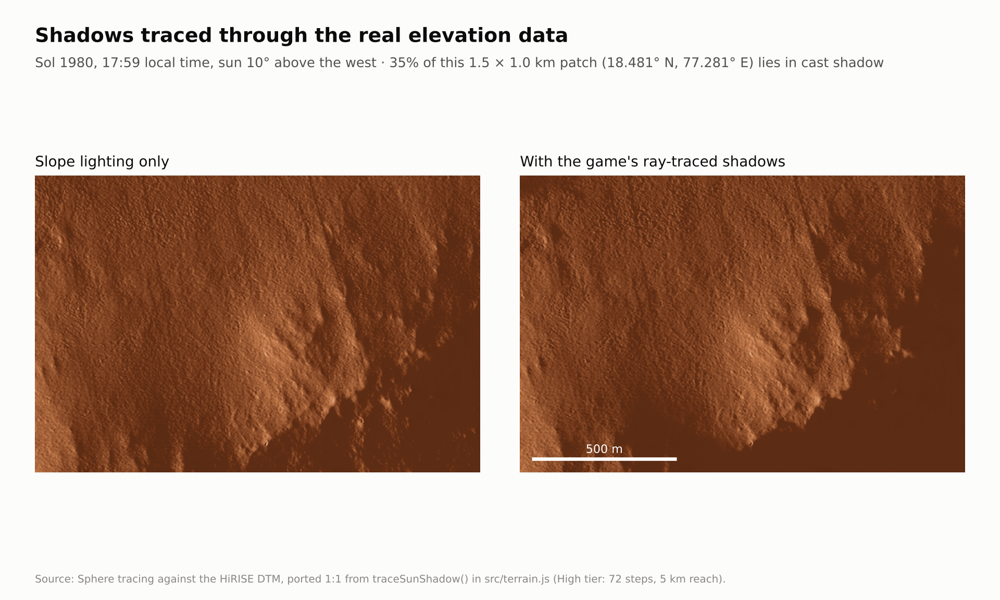
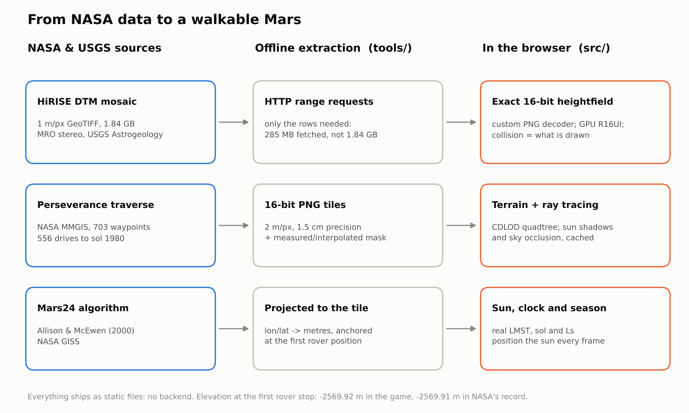

# Martian Story — Jezero Crater

A browser-based Mars surface exploration prototype built on **real NASA and USGS
data**. You walk the floor of Jezero Crater on the actual HiRISE elevation model,
along Perseverance's actual traverse, under a sun placed by the actual Mars24
timekeeping algorithm.

No build step, no bundler, no backend. Clone, run one command, open a page.

**Play online: <https://clicktwice26.github.io/martian-story/>** (GitHub Pages; needs a WebGL2 browser)

---

## What is real, and what is not

This matters more than any feature list, so it goes first.

| | |
|---|---|
| **Elevation** | Real. USGS Mars 2020 TRN HiRISE DTM mosaic, 1 m/px, six stereo pairs. Verified: the landing site reads **-2569.92 m** here against NASA's recorded **-2569.91 m**. |
| **Rover track** | Real. 703 waypoints and 556 drive segments through **sol 1980**, 45.13 km. |
| **Mars clock** | Real. Allison & McEwen (2000), the Mars24 algorithm. Landing → mission sol 0 exactly; today → sol 1985 against NASA data ending at 1980. |
| **Sun position** | Real. Derived from Ls, solar declination and local true solar time at 18.44°N, 77.45°E. |
| **Shadows** | Real rays, traced against the real elevation data. |
| **9.31% of the main tile** | **Interpolated, not measured.** The rectangular window overruns the union of the stereo footprints. Marked by a validity mask and rendered desaturated — press **M** to toggle. |
| **Sub-metre surface** | **Synthesised.** A 2 m/px DTM cannot hold ripples or rocks (Nyquist), so that band is generated — but *driven by* the measured slope, not invented freely. See [Surface detail](#surface-detail). |

## Quick start

Requires Go (for the static server) and a WebGL2 browser. Nothing else.

```bash
git clone https://github.com/clickTwice26/martian-story.git
cd martian-story/server && go build -o jezero-server .
./jezero-server -dir .. -port 8123
```

Then open <http://localhost:8123/>.

The game needs a server only because browsers refuse ES modules and `fetch()` on a
`file://` origin. There is no backend — it deploys to any static host as-is.

### Hosting on GitHub Pages

Settings → Pages → *Deploy from a branch* → `main`, folder `/ (root)`. Every push to
`main` republishes the site. All paths are relative, so it works from the
`/martian-story/` sub-path; `.nojekyll` makes Pages serve the files untouched.

### Controls

| | |
|---|---|
| `WASD` | move · `SHIFT` run · `SPACE` jump |
| `Mouse` | look. If your browser refuses pointer lock, **drag with the left button** — both work |
| `V` | first / third person · `F` survey (free-fly) mode |
| `G` | cycle ray tracing · `M` gap-fill overlay · `T` rover track · `B` head bob |
| `H` | call the support unit · `SHIFT+H` heel / roam |
| `Q` / left click | punch (press again for a jab–cross combo) · throw what you are carrying |
| `X` / right click | defend — hold to keep the guard up |
| `E` | use what you face (refill, build, rest…) · grab the rock or crate in front of you · press again to put it down |
| `J` | mission journal: objectives, stats, badges, the science you have unlocked |
| `,` `.` | time of sol · `ESC` settings |
| `SPACE` (hold) / `ESC` | skip the opening cinematic |

Every binding is rebindable under Settings → Controls. Gamepads work through the
standard mapping (`X` punch, `Y` grab, `LB` block). Mouse buttons only act while
the pointer is captured; in drag-to-look mode use the keys.

### The opening

A 100-second cinematic plays before you take control (hold `SPACE` or press
`ESC` to skip; turn it off under Settings → World):

1. **Black.** The courier *Kestrel*, day 212 of an Earth–Mars transfer; one crew
   member in hibernation, the support unit **K-7** at the helm.
2. **The solar system.** A blooming sun, orbits, Earth and Mars with info cards,
   the Kestrel's transfer arc, the title.
3. **The ship and its pilot.** The Kestrel gliding on twin energy beams; the
   robot at the controls in the cockpit.
4. **Mars.** Valles Marineris and the Tharsis volcanoes swing into view as
   Phobos crosses the disc.
5. **The strike.** Debris takes out the port engine: alarms, red light, the
   entry corridor lost, plasma building on the hull.
6. **Jezero, sol 1980, 17:15.** On the real DTM, a fireball comes out of the low
   western sun, roars overhead and ploughs into the crater floor. The boom
   arrives late, because sound crosses Mars at ~240 m/s, and low-passed, because the
   thin CO₂ air carries almost nothing above 240 Hz.
7. **Aftermath.** Dust settles; K-7 gets up beside the wreck and calls for you,
   and the camera lands behind your astronaut where play begins.

The wreck, its smoke column and the debris along the furrow **stay in the
world** (with collision), whether or not the opening is watched.

Everything is procedural and offline: planets and the galaxy are baked once
into textures during loading (Mars carries its real landmarks at their real
coordinates, Jezero included), the ship is built from primitives and a painted
canvas, and the score is synthesised in Web Audio. Acts I–II render through a
small HDR post chain (mip-chain bloom, ACES, grade, vignette, grain, lens flare)
that costs less than a gameplay frame; act III is the game's own renderer.

### Part Two: Survive Jezero

After the crash the game becomes a survival campaign of **14 missions in five
acts**, built on the numbers in the
[research report](reports/Mars%20survival%20resources%20from%20NASA%20data.md).
Turn it off under Settings → World → Story Missions. Progress is saved in the
browser; press `R` twice in the journal to start over.

| Act | Missions | What you do, and the science behind it |
|---|---|---|
| I | First Breath · Salvage · Shelter · Sunlight | Refill a failing suit (0.84 kg O₂ per person per sol), haul crates under 0.38 g, inflate the habitat and bury it under regolith (a thin layer is *worse* than none: secondary neutrons), deploy a solar array whose output follows the real Mars24 sun |
| II | Make Air · No Ice Here · Poison in the Water · Green | Run a MOXIE-style CO₂ electrolyser; learn there is no ice at 18°N and bake water out of hydrated sulfate instead (NASA M-WIP study grades, 50% recovery from NASA Glenn tests); remove perchlorate; grow food hydroponically |
| III | Dust Storm · Fission | Ride out a regional storm on a starving battery; tow the Kestrel's 10 kWe reactor out to 80 m — NASA's 2024 choice for Mars surface power |
| IV | Cargo from Home · The Way Home · Full Tanks | Recover a resupply pod; install a Sabatier reactor (each tonne of methane costs 2.25 t of water) and run the plant for ~300 sols, fixing dust and jammed augers |
| V | Ascent | Launch on Martian propellant. K-7 stays behind. |

**The life-support budget runs for real.** While the story plays, the Mars clock
runs at 60× (a Mars minute per second), so day and night, the sun's elevation and
with it the solar output all follow Mars24 at Jezero. The HUD tracks suit and
habitat oxygen, battery and generation, water, food, outside temperature (from
Perseverance's MEDA ranges) and **radiation dose against NASA's 600 mSv career
limit** — you arrive with 390 mSv already, 212 days of cruise at Curiosity RAD's
1.84 mSv/day. Resting in the habitat skips time, integrating the same budget in
quarter-hour steps against the real sun.

Every mission ends with a *science unlocked* card naming its NASA or peer-reviewed
source, collected in the journal. Values scaled for play are labelled there: the
O₂ stack is a 10× MOXIE (120 g/h on 3 kW, MOXIE's own energy ratio), the array is
60 m², ore grades span the M-WIP study's 4–20% range, and the propellant load is
for a small pod. Points, ranks (Castaway → Ares Legend) and eight badges reward
doing it well — under the dose limit, without a blackout, with the battery alive
through the storm.

---

## How it works

### Getting the terrain without downloading 1.84 GB

The source GeoTIFF is 1.84 GB. It is also *uncompressed 32-bit float with
`RowsPerStrip=1`*, and the S3 bucket honours byte ranges — so every raster row is
an independently addressable byte run. `tools/extract_dtm.py` parses the TIFF
directory, then fetches only the rows it needs with 32 parallel range requests
(0.13 → 1.17 MB/s, 9× faster) and decimates on the fly.

**285 MB transferred instead of 1.84 GB**, in about five minutes.

Output: a 16-bit PNG per tile plus a JSON sidecar carrying the georeferencing.
16-bit matters — 8-bit over Jezero's 1006 m range would quantise to 3.9 m steps.
At 16-bit the base tile resolves to **1.54 cm**, the detail tile to **0.97 mm**.

### Terrain rendering

CDLOD quadtree, one instanced draw call, morphed vertex transitions so LOD
switches never pop. Leaves are 16 m over a 64-segment patch → **0.25 m vertex
spacing** near the camera, which is what makes sub-metre detail representable at
all. The tree subdivides **lazily** (eager would be ~10⁶ nodes) and prunes behind
you: about 400 nodes exist at any time.

Elevation is read as an `R16UI` integer texture and bilinearly filtered by hand,
so the GPU sees the exact same `uint16` the CPU does and collision cannot drift
from what is drawn.

### Ray tracing

No browser exposes hardware ray tracing — WebGPU does not surface RT cores and
WebGL2 certainly does not. But a heightfield is a *graph*, so the vertical gap
between ray and terrain is a usable proximity bound and the ray can be advanced
by it. These are genuine sphere-traced rays against the real DTM:

- soft sun shadows with a real penumbra from closest approach
- horizon-traced ambient occlusion

Five tiers from Off to Ultra (0 → 696 texel fetches per pixel).

### Performance: only pay for what is seen and near

Most of the frame used to go on work nobody could see, or on recomputing last
frame's answer. The engine now scales its effort with visibility and range:

- **Cached ray-traced lighting.** Shadow and AO depend on the ground and the
  sun, not the camera, so the same rays are traced once per DTM texel into
  textures — a 4 km window at 2 m around you plus the whole tile at 8 m — and
  the terrain does one lookup per pixel instead of up to 696 fetches. Rebaking
  happens only when the sun moves ~0.04° or you travel 600 m, sliced across
  frames into a back buffer so it never hitches. Toggle under Graphics.
- **Adaptive quality.** When the frame rate falls below target, render scale
  *and* terrain LOD drop together by the square root of the shortfall, and
  climb back with headroom. Both levers are needed: on integrated GPUs the
  terrain is vertex-bound, so lowering resolution alone only blurs the image.
  If both sit at their floors and it is still too slow, the terrain mesh steps
  down a density for the session. Never exceeds the settings you chose; the
  render scale moves in 5% steps, since each change reallocates the framebuffer.
- **Terrain LOD capped at data resolution.** Beyond the synthesised-detail band
  (and a 64 m interaction radius) patches stop subdividing once their vertices
  are as dense as the 2 m DTM, since finer triangles would only redraw the same
  bilinear ramps. Nodes outside the view frustum were already skipped.
- **Distance-faded shading detail.** Metre-scale noise is sub-pixel past ~300 m;
  it is faded out and its 12 noise evaluations skipped there.
- **Rocks** are built in 49 m chunks that are frustum-culled individually, and
  rocks too small to cover a couple of pixels at their distance are not drawn.
- **Rover track** is split into 1 km tiles so only on-screen stretches draw.
- **Animation LOD.** The support unit's skeleton is posed every frame up close,
  every 2nd/4th frame further out, and not at all off screen; the crew body is
  not animated in first person. AI and movement still run every frame.

- **Terrain mesh density.** Every quadtree node draws the same instanced patch,
  so triangles go with its segment count squared. Low / Medium / High use
  32 / 48 / 64 segments (0.46 M / 1.0 M / 1.5 M triangles at the start).
- **Fewer fetches per vertex.** The height and its normal come from one 12-texel
  block instead of five separate bilinear samples (20 fetches), with identical
  results, so collision still matches the drawn surface.
- **Front-to-back terrain.** Patches are written nearest-first into the
  instanced draw, so the depth test rejects hidden ground before it is shaded.
- **Nothing expensive after "Click to explore".** The lighting cache is baked
  and every shader compiled behind the loading screen, so the first seconds of
  play neither ray-march live nor stall on a driver compile.
- **Lighter lighting cache.** Shadow and AO are stored as RG8, half the memory
  and read bandwidth of RGBA8; re-bakes run in thinner slices while adaptive
  quality is cutting back.

### Running on low-end hardware

On first run (no saved settings) a software renderer, an Intel / Mali / Adreno /
PowerVR GPU, or a ≤4-core ≤4 GB device gets the **Low** preset automatically:
32-segment mesh, no MSAA, 0.75 render scale, cached ray-traced shadows kept on
(they cost one lookup per pixel). Saved choices are never overridden. MSAA
(Settings → Graphics) only changes after a reload, because WebGL fixes it when
the context is created.

Measured on a CPU-only software GPU (SwiftShader, 4 cores, 960×540), the live
game loop went from ~10 s per frame to ~0.3 s per frame on Low. Terrain frame
time by setting:

| | Terrain frame | Triangles |
|---|---|---|
| Before, defaults | 1,657 ms | 1.53 M |
| Mesh 48 | 1,128 ms | 0.99 M |
| Mesh 32 | 628 ms | 0.46 M |
| Low preset | 414 ms | 0.30 M |

The HUD's RENDER panel shows the live render scale, terrain LOD and mesh
segments, and whether lighting is cached or traced live.

### Surface detail

A 2 m/px DTM contains nothing under ~4 m. Those missing objects — rocks, ripples,
pebbles — are exactly what the eye uses to judge scale, which is why a correctly
sized 1.85 m astronaut reads as a giant on raw DTM. So the band is synthesised:

- **aeolian ripples** at Jezero's real ~2.2 m wavelength, amplitude ~10 cm
- **scattered float rock**, density from *measured* slope: 0.79 rocks per 7 m cell
  on the crater floor rising to 3.9 near scarps

Both are applied **identically on CPU and GPU**, so you walk on the surface you
see. That required an integer hash rather than the usual `fract(sin(x)*43758)`,
which is chaotic and produces completely different values in float32 and float64
— verified bit-exact across 20,000 samples.

### Planetary curvature

Mars' radius is 3,396 km against Earth's 6,371, so from 1.62 m eye height the
horizon sits **3,317 m away instead of 4,543 m**. The terrain is bent by `d²/2R`
about the camera, dropping exactly 1.62 m at that distance. The rover track bends
with it via `onBeforeCompile`, so it never floats off the ground at range.

### Movement

Your mass does not change on Mars, only your weight. Traction is `μ·m·g`, so every
horizontal manoeuvre is capped near **2.0 m/s²** instead of Earth's 5.4 — you
accelerate slowly, slide when you stop, and cannot turn sharply.

Measured against prediction: acceleration 1.98 vs 2.05 m/s²; stopping distance
0.424 vs 0.440 m (0.167 m on Earth); sliding begins at 32° against a predicted
angle of repose of `atan(0.55)` = 28.8°.

### Character actions: punch, defend, grab

The donor model ships with idle, walk and run, and nothing else. Rather than
author a clip per verb per model, an action is described as *where the hands
go*: a hand target and an elbow pole in the character's own frame, plus how far
to crouch and bend. `rig.js` turns that into joint rotations with analytic
two-bone IK, layered after the animation mixer. Arms reach, knees bend to keep
the boots planted, the spine flexes and twists. Nothing is specific to this
skeleton: proportions are measured off whatever Mixamo / Ready Player Me rig
is loaded.

- **Punch** — guard, strike, recover in 0.42 s. The torso turns into it, the
  other hand covers the visor, and a second press chains a cross. The fist
  delivers ~28 N·s, which knocks a cobble loose and does nothing to a boulder.
- **Defend** — forearms up in front of the visor while held; you can still
  move, at half speed.
- **Grab** — step in, squat, get both hands round the rock, lift it to the
  chest. Mass comes from its real volume at basalt density (2,900 kg/m³). The
  lift limit is 80 kg — only ~30 kg-force on Mars, but the mass, and the
  effort of moving it, is all still there. Heavier rocks get a strained attempt
  and a note on why. Carrying slows you, rules out running above 25 kg and
  jumping above 40 kg. Press again to set it down, or punch to throw it — the
  same push leaves a lighter rock faster.

Rocks are procedural, regenerated from a hash whenever the camera crosses a
cell, so "picking one up" removes its key from the field and swaps in an
identical loose body in the same place. Dropped and thrown rocks fall, bounce
and slide under Mars gravity with the boots' own μ = 0.55, then sleep.

The pieces are separate so they can be reused anywhere:

| | |
|---|---|
| `rig.js` | `HumanoidRig` — the pose layer for any humanoid skeleton |
| `actions.js` | `CharacterActions` — the state machine; no input, camera or mesh code |
| `interact.js` | `Interactables` registry, `Prop` loose bodies, `RockSource` adapter |

```js
const actions = new CharacterActions({ world: interactables, ground: hf.heightAt.bind(hf), dims: rig.dims });
actions.punch(); actions.setDefend(true); actions.grab();       // from input, or from AI
actions.update(dt, { pos, yaw, aimYaw, vel });                  // each frame
rig.apply(actions.pose);                                        // after the mixer
```

Anything with `position`, `radius`, `mass` and `take()` (plus an optional
`hit()`) can be registered as grabbable through a provider's `query()`.

### Audio

Synthesised entirely in Web Audio — no sample files. Mars' atmosphere is ~610 Pa
of CO₂, and Perseverance's SuperCam microphone confirmed it crushes everything
above ~240 Hz. Outside is nearly silent. So what you hear is your suit: breathing
(tightening 13 → 35 breaths/min with exertion), the ventilation fan, the
regulator, and footfalls conducted up through the boots as structure-borne
vibration rather than through air.

---

## Data and algorithm figures

Computed from the files in this repository by `python3 tools/make_figures.py`
(light and dark versions in `docs/figures/`). The elevation check is the headline:
on ground HiRISE measured, the game's terrain sits a **median 4 cm** from NASA's own
recorded rover elevations (612 positions, 85% within 1 m); on the gap-filled strip
it is off by ~120 m, which is exactly why the game marks that ground.

<picture>
  <source media="(prefers-color-scheme: dark)" srcset="docs/figures/dark/1-jezero-terrain-and-traverse.png">
  
</picture>

<picture>
  <source media="(prefers-color-scheme: dark)" srcset="docs/figures/dark/2-measured-vs-interpolated.png">
  
</picture>

<picture>
  <source media="(prefers-color-scheme: dark)" srcset="docs/figures/dark/3-terrain-vs-nasa-rover-elevation.png">
  
</picture>

<picture>
  <source media="(prefers-color-scheme: dark)" srcset="docs/figures/dark/4-mars24-sun-at-jezero.png">
  
</picture>

<picture>
  <source media="(prefers-color-scheme: dark)" srcset="docs/figures/dark/5-ray-traced-shadows.png">
  
</picture>

<picture>
  <source media="(prefers-color-scheme: dark)" srcset="docs/figures/dark/6-data-pipeline.png">
  
</picture>

## Layout

```
index.html              entry point
src/
  main.js               bootstrap, frame loop, HUD
  terrain.js            CDLOD quadtree + ray-traced shading
  lightcache.js         bakes the ray-traced shadow/AO into textures, sliced over frames
  heightfield.js        elevation sampling, measured vs detailed
  detail.js             sub-DTM synthesis + rock scatter
  marstime.js           Allison & McEwen / Mars24
  player.js             traction-limited movement
  input.js              rebindable actions, gamepad, pointer-lock fallback
  astronaut.js          crew body on a Mixamo rig
  rig.js                procedural pose layer: two-bone IK arms/legs, crouch, spine bend
  actions.js            punch / defend / grab / carry / throw state machine
  interact.js           grabbable registry, loose props with Mars physics, rock adapter
  companion.js          autonomous support unit
  audio.js              Web Audio suit synthesis
  settings.js/ui        declarative settings, one schema drives menu and engine
  sky.js, shaderlib.js, png16.js, settingsui.js
  intro/
    intro.js            the opening's director: timeline, shots, captions, wreck site
    space.js            galaxy, stars, sun, planets with atmospheres
    bake.js             procedural planet / galaxy bakes (Mars landmarks, Earth, Jupiter)
    ship.js             the Kestrel, its pilot, plumes, plasma sheath, and the wreck
    particles.js        instanced billboard particles and ballistic debris
    post.js             HDR bloom + grade composite for the space acts
    score.js            synthesised score and Mars-correct sound design
  survival/
    campaign.js         Part Two's 14 missions: objectives, K-7's lines, science cards and sources
    survival.js         life-support budget, stations, crates, rest / time skip, HUD, journal, save
    models.js           procedural hab, berm, solar array, O2 plant, oven, greenhouse, reactor, pod
reports/, research_notes/  the NASA survival research the campaign is built on
data/                   baked NASA tiles + rover traverse
tools/                  the range-request extractors, and make_figures.py
docs/figures/           reference figures for the data and algorithms (light / dark)
server/                 Go static server (range requests, gzip, correct MIME)
vendor/                 three.js r160 + rigged models, all local
prototypes/             an earlier unrelated sandbox prototype
```

## Data provenance and licences

See **[NOTICE.md](NOTICE.md)**. Short version: the Mars data is public domain
(US Government), three.js and its models are MIT, the timekeeping follows a
published paper.
